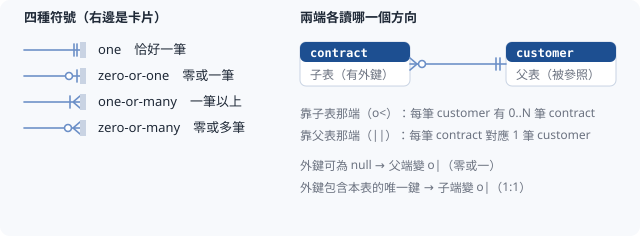

# ER Diagram Renderer

把一份資料庫 schema JSON 渲染成 DBdocs 式的資料庫文件：**導覽樹**、**Wiki** 與**關聯圖**。

## 它畫出什麼

### 外殼（v1.2.0 起）

- **導覽樹**：Schema → 分群 → 資料表三層，可篩選（比對表名、表的中文標籤與欄位名，附「命中／總數」）、可收合。
  資料沒有 `schemas` 時省略 Schema 那一層，直接從分群開始 —— 只有一個節點的層級沒有意義
- **Wiki／Diagram 兩個分頁**，互相跳轉：Wiki 的「在 Diagram 聚焦」、Diagram 聚焦列的「開啟 Wiki」；
  在 Diagram 點一張表，切回 Wiki 就是那張表
- **記得上次看到哪**：目前的頁面、分頁與範圍存在瀏覽器（localStorage，依資料檔路徑區分），reload 回到原處；
  資料改名後殘留的無效位置會回到總覽
- **兩種情境**：獨立頁（`/view/<路徑>`）外殼隨內容長高、分頁列與導覽黏在頂端；
  內嵌在筆記裡時是 580px 高的框、導覽預設收起，可「展開全寬」攤開整個外殼
- **窄寬度**（外殼 ≤ 760px，看的是外殼自己的寬度而非視窗）：導覽改為覆蓋在內容上

### Wiki

- **總覽**：資料庫標題、統計（schemas／表／欄位／外鍵）、`meta.description`、各 schema 卡片、本份資料的語彙（必填性、欄位徽章、衍生欄）
- **Schema 頁**：schema 說明，以及每個分群的說明與資料表清單（說明摘要、欄位數、父／子表數）
- **Table 頁**：表說明、欄位表（型別、必填、預設、PK／FK／UQ／IX 與衍生徽章、說明；外鍵寫出實際參照的父表欄位、可點到父表）、
  **局部關聯圖**（父表 ← 本表 ← 子表，各最多畫 8 張，每條外鍵一條線、兩端畫多重性）、
  參照／被參照清單（附多重性文字，例：`N:1`、`1:N（可選）`、`1:1`、「至少一筆」）、多對多（經由哪張中間表）、索引與唯一鍵（含複合）、衍生欄

`description` 全部選填，缺漏時照常渲染並顯示空狀態。

### Diagram

- **可縮放平移的無限畫布**（v1.1.0）：拖曳平移、⌘/Ctrl＋滾輪縮放（觸控板捏合同樣有效）、
  雙擊空白處或按右下的還原鈕回到起點。開啟時自動 fit **寬度**（不是整張圖 ——
  這種版面往下長，用寬高都塞得下的倍率去 fit 會被高度壓到讀不到字），
  之後就交給你，動過視角後不會再被自動拉回。
  單純滾輪一律放行給頁面捲動，畫布不會把滾輪吃掉讓你出不去
- **固定欄數的版面**：模組分群由上而下堆疊，欄序自己指定 —— 相鄰欄放關係密切的模組，
  多數外鍵就只跨一欄，連線不必繞遠路
- **範圍**（v1.2.0）：只畫某個 schema 的表；跨範圍的連線不畫，但會註明有幾條
- **關聯連線**（v1.3.0 起畫多重性）：由 `foreignKeys` 與欄位的 `fk` 推導，量測卡片實際位置後畫貝茲曲線；
  線的兩端是 crow's foot 符號（見下方〈多重性〉），複合外鍵畫成一條線。縮放列的「圖例」可隨時查符號意思
- **收合中間表**（v1.3.0）：多對多的中間表可以收成只剩標題列，兩端的表之間改畫一條 M:N 的線；點那張小卡會改畫它真實的兩條外鍵
- **聚焦**：點一張表，它的父表與子表保持清晰、其餘變淡，並列出「指向 N 張父表、被 M 張子表指向」
- **搜尋**：比對表名、表的中文標籤與欄位名，附命中數（沒有這個數字，「查不到」與「沒在查」長得一樣）
- **hub 表收折**：被極多張表指向的共用表（例：選項主檔），連線預設收起 ——
  不收的話整張圖會被它的放射狀線條蓋滿
- **Esc 逐層退**：先關圖例、取消聚焦，再收起覆蓋式導覽，最後離開全寬；在筆記的「放大檢視」裡也一樣

### 資料問題（v1.3.0）

外鍵指向不存在的表或欄位、欄數對不上、參照的不是主鍵或唯一鍵、`junction` 條件不成立…這些 JSON Schema 驗不出來的問題，
開發模式下印在瀏覽器 console，build 時也印在 build log（每個資料檔一次）。**只提示、不會讓 build 失敗**，有問題的外鍵照規則略過或照畫。

| 代碼 | 意思 |
| --- | --- |
| `fk-missing-table` | 父表不存在，這條外鍵不畫 |
| `fk-missing-column` | 外鍵欄位不在本表 |
| `ref-missing-column` | 參照欄位不在父表 |
| `fk-arity` | 本表與父表的欄數不同 |
| `ref-no-pk` | 父表沒有主鍵，又沒寫參照欄位 |
| `ref-not-unique` | 參照的欄位不是父表的主鍵或唯一鍵 |
| `fk-duplicate` | 重複的外鍵；或欄位 `fk` 與表層 `foreignKeys` 寫同一欄卻指向不同 |
| `fk-maybe-composite` | 好幾個單欄 `fk` 合起來剛好是父表的複合主鍵，可能是一條複合外鍵 |
| `junction-invalid` | 標了 `junction: true`，但外鍵不是剛好兩條 |
| `junction-not-unique` | 標了 `junction: true`，但兩條外鍵的欄位合起來不是主鍵或唯一鍵 |

## 資料長什麼樣

完整規格見 [schema.json](./schema.json)。可跑的範例：
[example/schema.json](./example/schema.json)（v1.3：3 個 schema、17 張表，含 1:1、可選外鍵、複合主鍵與外鍵、非 `id` 的參照欄位、多對多中間表）、
[example/schema.v1.2.json](./example/schema.v1.2.json)（v1.2 格式）、
[example/schema.v1.1.json](./example/schema.v1.1.json)（v1.1 格式）。舊版兩份原樣保留作相容測試，三份都用目前的 `schema.json` 驗證。

```jsonc
{
  "$schema": "https://raw.githubusercontent.com/SteveLin100132/notecraft/main/plugins/er-diagram-renderer/schema.json",
  "meta": {
    "title": "…",
    "description": "Wiki 總覽頁內文，**允許 Markdown**",
    "source": "…",
    "backTo": "/notes/…"
  },
  "options": { "defaultRows": 6, "hubTables": ["option_item"], "canvasHeight": 640 },

  // 語彙都是資料，不是寫死的 —— 換個專案可以改叫法
  "requirement": [{ "key": "required", "label": "必填", "marker": "solid" }],
  "flags":       [{ "key": "pk", "badge": "PK", "tone": "danger", "label": "主鍵" }],
  "derivations": [{ "key": "trigger", "badge": "TRG", "label": "由 trigger 維護" }],

  // v1.2：導覽第一層，順序即導覽順序（選填）
  "schemas": [{ "key": "crm", "label": "客戶關係", "description": "…（Markdown）" }],
  "groups":  [{ "key": "customer", "label": "客戶", "schema": "crm", "description": "…（Markdown）" }],
  "layout":  { "columns": [{ "key": "c1", "groups": ["customer"] }] },

  "tables": [{
    "name": "customer", "label": "客戶主檔", "section": "2.1", "group": "customer",
    "description": "…（Markdown，Table 頁的表說明）",
    "columns": [
      { "name": "id", "type": "bigint", "required": "system", "pk": true, "note": "代理主鍵" },
      { "name": "industry_id", "type": "bigint", "required": "nullable", "fk": "option_item", "note": "產業類別" },
      // v1.3：fk 可寫「表名.欄位名」；nullable 寫在欄位上，優先於 requirement[].nullable
      { "name": "type_code", "type": "varchar(20)", "required": "required", "fk": "option_type.code" },
      { "name": "referrer_id", "type": "bigint", "required": "required", "nullable": true, "fk": "customer" }
    ],
    // v1.3：複合外鍵、明確多重性
    "foreignKeys": [{
      "name": "fk_customer_region",
      "columns": ["country", "region_code"],
      "references": { "table": "region", "columns": ["country", "code"] },
      "cardinality": { "child": "one-or-many" },
      "note": "…"
    }],
    // v1.3：複合唯一鍵與一般索引
    "indexes": [{ "name": "uq_customer_tax", "columns": ["country", "tax_id"], "unique": true }],
    // v1.3：中間表（true 明確標示、false 關掉自動判斷、不寫自動判斷）
    "junction": false
  }]
}
```

v1.3 的 `requirement` 項目可以加 `"nullable": true`，表示這個必填性在資料庫層可為 null（例：「可空」「條件必填」）。

**關聯不要另外存一份。** `edges` 由 `tables[].foreignKeys` 與 `columns[].fk` 推導 —— 存了就會有兩份真相，改一邊忘另一邊。
同理，索引與唯一鍵清單由 `pk`／`unique`／`index` 推導，衍生欄清單由 `derivation` 推導，父／子表數由關聯推導。

### v1.1 → v1.2：全部是選填新增

| 位置 | 新欄位 | 用途 |
| --- | --- | --- |
| 頂層 | `schemas[]`（`key`、`label`、`description?`） | 導覽第一層 |
| `meta.description` | 語意擴充：允許 Markdown | Wiki 總覽頁內文 |
| `groups[]` | `schema`、`description` | 分群歸屬哪個 schema、Schema 頁的分群說明 |
| `tables[]` | `description` | Table 頁的表說明 |

- **v1.1 的資料檔不改也能跑**：沒有 `schemas` 時全部分群歸在一個隱含的 schema 下，介面自動省略 Schema 那一層、Diagram 不顯示範圍切換
- `groups[].schema` 沒寫或指向不存在的 key：歸入第一個 schema，開發模式下 console 警告一次（不會讓頁面壞掉）
- `layout.columns` 仍決定 Diagram 版面，也決定導覽樹裡分群的順序（沒出現在 layout 的分群接在最後）
- 用 v1.1 的 `schema.json` 驗證 v1.2 資料會失敗（`additionalProperties: false`），這是預期的 —— 請用本版的 schema

### v1.2 → v1.3：全部是選填新增

| 位置 | 新欄位 | 型別 | 用途 |
| --- | --- | --- | --- |
| `requirement[]` | `nullable` | boolean | 這個必填性在資料庫層可否為 null；欄位沒寫 `nullable` 時採用 |
| `tables[].columns[]` | `nullable` | boolean | 這一欄可否為 null，優先於語彙 |
| `tables[].columns[].fk` | 語意擴充 | string | `"表名"`（參照主鍵）或 `"表名.欄位名"`（參照指定欄位） |
| `tables[]` | `foreignKeys` | `{ name?, columns, references: { table, columns? }, cardinality?, note? }[]` | 複合外鍵、參照主鍵以外的唯一鍵、明確指定多重性 |
| `tables[]` | `indexes` | `{ name?, columns, unique?, note? }[]` | 表層索引與唯一約束，可以多欄 |
| `tables[]` | `junction` | boolean | 中間表標示（見下方〈多對多〉） |
| `options` | `collapseJunctions` | boolean | Diagram 預設是否收合中間表（預設 `false`） |

- **v1.2 的資料檔不改也能跑**：沒有 nullable 資訊時一律當作不可為 null，所以父端顯示「恰好一筆」；子端依欄位上的 `unique`／`pk` 推導
- `fk` 寫表名時參照父表的主鍵：v1.2 的範例主鍵都叫 `id`，Wiki 顯示與以前相同
- 欄位 `fk` 與表層 `foreignKeys` 寫同一欄時，以表層為準
- **行為變化**：v1.1／v1.2 資料裡帶 `unique` 的外鍵欄位會自動畫成 1:1。例如 v1.1 範例的 `contract.sign_item_id`（`fk: option_item`、`unique: true`）現在是 1:1。這筆資料是原樣保留的相容測試資料，所以沒改
- 用 v1.2 的 `schema.json` 驗證 v1.3 資料會失敗（`additionalProperties: false`），請用本版的 schema

### 多重性

線的兩端是 crow's foot（IE notation）符號。**靠父表那端**是「每筆子資料對到幾筆父資料」，**靠子表那端**是「每筆父資料有幾筆子資料」。



| 符號 | 值 | 意思 |
| --- | --- | --- |
| `\|\|` | `one` | 恰好一筆 |
| `o\|` | `zero-or-one` | 零或一筆 |
| `\|<` | `one-or-many` | 一筆以上 |
| `o<` | `zero-or-many` | 零或多筆 |

不寫也有合理結果，由約束推導；寫了 `foreignKeys[].cardinality` 就以明確值為準（只寫一端時另一端照推導，與約束矛盾也照畫）：

| 端 | 推導規則 | 可明確指定 |
| --- | --- | --- |
| 父端 | 外鍵欄位**都不可為 null** → `one`；任一欄可為 null → `zero-or-one` | `one`、`zero-or-one` |
| 子端 | 外鍵欄位**包含本表的某個唯一鍵**（主鍵、單欄 `unique`、`indexes[].unique`）→ `zero-or-one`（1:1）；否則 `zero-or-many` | 另有 `one-or-many`、`one`，這兩個**只能明確寫**（約束表達不了「至少一筆」） |

可否為 null 的判定順序：欄位的 `nullable` → 該欄 `required` 對到的 `requirement[].nullable` → 都沒寫就當作不可為 null。不會依語彙的名稱去猜。

參照欄位：`references.columns` → `fk` 簡寫的欄位名 → 父表的主鍵（多個 `pk: true` 就是複合主鍵）。參照的欄位必須是父表的主鍵或唯一鍵。

Wiki 的多重性文字從該頁的表出發：參照清單寫 `N:1`、被參照清單寫 `1:N`；`（可選）`表示外鍵可為 null；子端是一筆以上時，被參照清單另標「至少一筆」；明確指定的標「指定」。

### 多對多

中間表是用兩條外鍵把兩張表連成多對多的表。`junction: true` 明確標示；不寫時，**三個條件都成立**就自動判斷為中間表：

1. 剛好兩條外鍵（指向同一張表也算，即自我多對多）
2. 兩條外鍵的欄位合起來**等於**本表的主鍵或某個唯一鍵
3. 兩條外鍵都不可為 null

中間表有自己的欄位（例：`role`、`created_at`）仍然算。`junction: false` 可以關掉自動判斷。
收合時線兩端的符號取自中間表兩條外鍵的子端，預設兩端都是「零或多筆」。

### Wiki 內文（Markdown）

`description` 只支援這幾種語法：`##`／`###` 標題、段落、`-`／`1.` 清單、`>` 引言、`**粗體**`、`` `code` ``、`[文字](url)`。
其餘（表格、圖片、HTML）一律當文字顯示。

- **自動連結**：反引號內容恰好是表名 → 連到該表的 Table 頁；恰好是 schema key → 連到 Schema 頁
- 表名與 schema key 撞名時表名優先；要明確指定就加前綴：`` `table:customer` ``、`` `schema:customer` ``
  （顯示時會去掉前綴；指向不存在的目標時原樣顯示，讓你看得出引用壞了）
- **連結只接受** `http(s):`、`mailto:`、單一 `/` 開頭的站內路徑、`#` 錨點；`javascript:`、`data:`、`//host` 等一律當文字

`meta.description` 同時是 NoteCraft 的頁面描述與搜尋索引來源。**notecraftapp ≥ 1.3.0** 會自動去除 Markdown 標記
（頁面描述與清單只取第一段、搜尋索引收全文）；在較舊的版本上仍能正常渲染，只是頁面描述處會看到原始符號。

## 安裝與使用

```bash
npx notecraftapp install-plugin er-diagram-renderer
```

然後在 `.notecraft/plugins.json` 加一條映射：

```json
{ "plugins": [{ "plugin": "er-diagram-renderer", "files": ["**/*.er.json"] }] }
```

`plugins.json` 的 `options` 會覆蓋資料檔自帶的 `options` —— 同一份資料被不同專案引用時，
覆寫權在引用的人手上。`options.canvasHeight` 指定 Diagram 畫布高度（px），不給就依情境自動決定；
`options.collapseJunctions` 讓 Diagram 一開始就收合中間表。

### 在筆記裡內嵌

```mdx
import PluginView from "@/components/PluginView.astro";

{/* src 的基準是筆記資料夾（notesDir），不是這篇筆記所在的資料夾 */}
<PluginView src="erd/sales.er.json" />

{/* options 只影響這一處內嵌，淺合併在 plugins.json 的 options 之上 */}
<PluginView src="erd/sales.er.json" options={{ collapseJunctions: true, canvasHeight: 640 }} />
```

- `src` 是資料檔相對於**筆記資料夾**的路徑，與 `plugins.json` 的 `files` 同一個基準。筆記放在 `notes/sales/overview.mdx`、資料檔在 `notes/erd/sales.er.json` 時，一樣寫 `src="erd/sales.er.json"`
- 資料檔必須被 `plugins.json` 的某條規則對到（例：`**/*.er.json`），否則 build 會失敗並指出原因
- 內嵌是 580px 高的框、導覽預設收起，可「展開全寬」；`anchor` 對本 plugin 沒有作用（它不讀網址 hash）
- 每一處內嵌都會帶著**整份**資料（inline 在頁面裡），大型資料檔請只內嵌少數幾處

## 從寫死資料的舊元件遷移

若你已經有一支「資料寫死在 tsx 裡」的 ER 元件，用轉檔腳本一次轉出來：

```bash
node scripts/er-schema-from-tsx.mjs <舊元件.tsx> <輸出.json> --title "…" --back "/notes/…"
```

它會抽出表定義與版面、把短鍵轉成長鍵、把每張表重複一份的 `groupLabel` 正規化成頂層 `groups`，
並補上原本寫死在程式裡的語彙。檔案會變大約 1.6 倍 —— 那是為可讀性付的錢，
壓縮過的短鍵 JSON 人改不動、AI 也難產。產物不含 v1.2 的新欄位，可直接通過 v1.2 schema；
要用 Wiki 就在轉出的檔案上補 `schemas` 與各層 `description`。

## 檔案

入口固定是 `renderer.tsx`（外殼、路由與同步），其餘由它 import：`nav.tsx`（導覽）、`wiki.tsx`（Wiki 三頁）、
`local-diagram.tsx`（局部關聯圖）、`diagram.tsx`（畫布）、`markers.tsx`（多重性符號）、`derive.ts`（資料推導：外鍵、多重性、中間表、資料問題）、
`markdown.tsx`／`markdown-text.ts`（迷你 Markdown）、`types.ts`、`styles.ts`。`cardinality-legend.svg` 是本文件的圖例。
